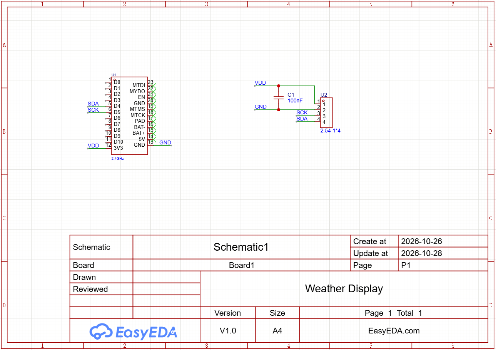
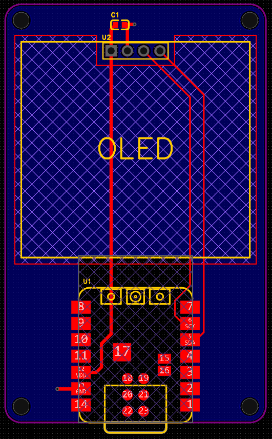
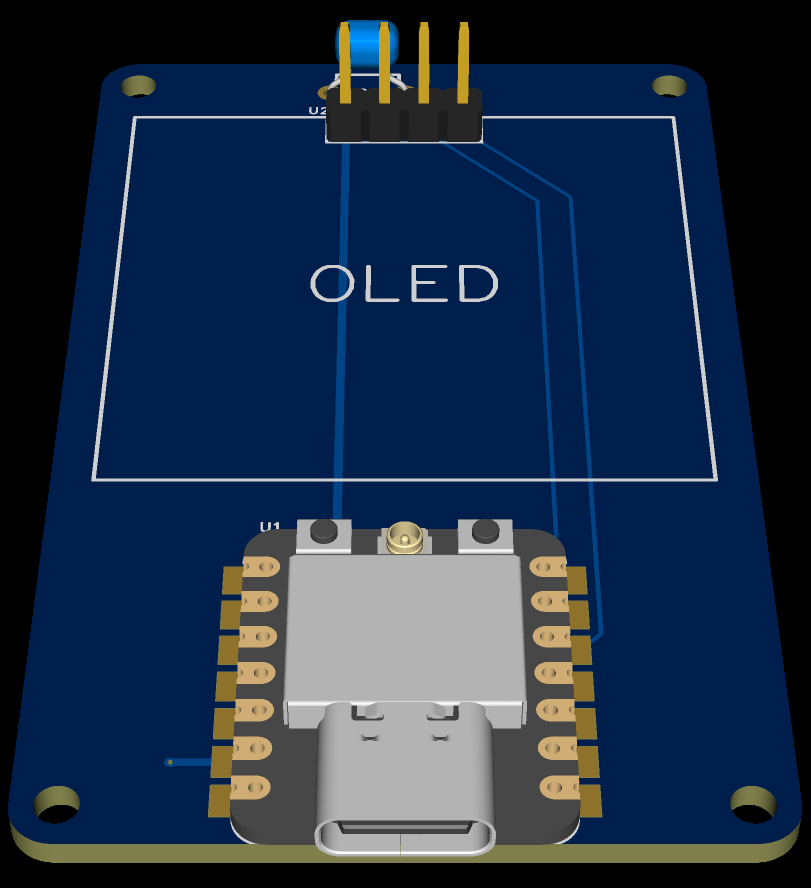
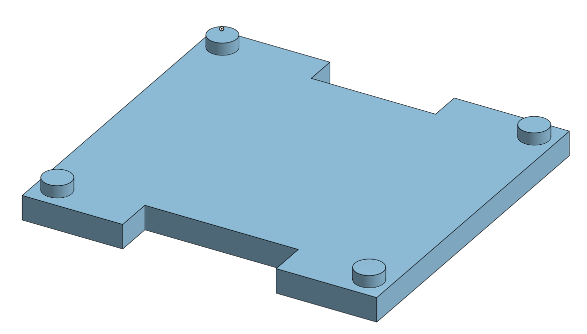
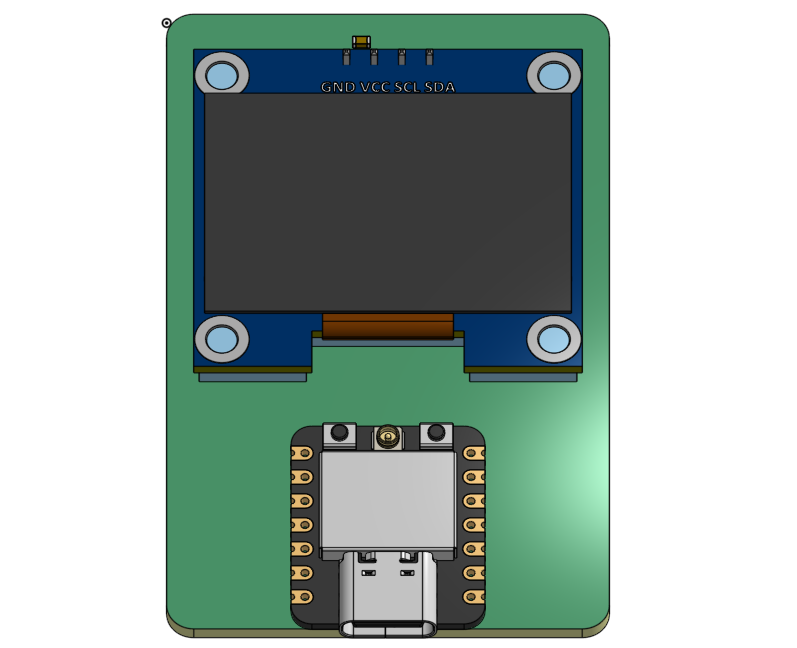

# Weather-Display

A display to show the temperature, precipitation, and a weather icon using API keys over Wi-Fi to retrieve these values.

I made this so I would be able to have an easy and fast method of accessing the weather in the morning.

## PCB
I made the Schematic and PCB using EasyEDA Pro. Linked is the [main project file](https://github.com/araschke001-commits/Weather-Display/blob/main/PCB/Weather%20Display%20PCB.epro2), the [source file for the schematic](https://github.com/araschke001-commits/Weather-Display/blob/main/PCB/Weather%20Display%20Schematic%20Source.json), and the [source file for the PCB](https://github.com/araschke001-commits/Weather-Display/blob/main/PCB/Weather%20Display%20PCB%20Source.json). Below are the images of it.

Schematic:

PCB:

PCB 3d Model:

## 3d Model
I imported the PCB into Onshape and made a [plastic stabilizer](https://github.com/araschke001-commits/Weather-Display/blob/main/OLED%20Stabilizer.step) to hold up the OLED there. ([Onshape link](https://cad.onshape.com/documents/d8afbd5a1b3dcb9baa82b799/w/5803ecc0fab9b01c42c92a63/e/ad6594a9bd6fcb596a3274d7?renderMode=0&uiState=6aec12e4aeed48659a011583))

Stabilizer Model:

Full 3d Model:

## Code
I made the firmware for this weather display with Micropython. I made some [test programs](https://github.com/araschke001-commits/Weather-Display/blob/main/Code/Test%20Programs), the [main program](https://github.com/araschke001-commits/Weather-Display/blob/main/Code/Weather%20Display%20Code.py), and even a module for the weather icons (both a [folder](https://github.com/araschke001-commits/Weather-Display/blob/main/Code/Modules/Weather%20Icons) with images and a [program](https://github.com/araschke001-commits/Weather-Display/blob/main/Code/Modules/weather_icons.py) with the bytearrays). I used both sh1106.py and urequests.py which I downloaded for use in this project.

## BOM
This is all you should need to make the Weather Display. The total comes to about $30 for the parts and shipping.

- 1x XIAO ESP32C3 - The microcontroller to get Wi-Fi and control the OLED
- 1x 1.3" OLED Display - The display to show the weather
- 1x PCB - The PCB the components go on (You can use PCBA, but I'm not)
- 4x M2x5mm Steel Standoffs - They keep the PCB pin headers off the ground so bad things don't happen
- 1x Capacitor - Decoupling capacitor between GND and VDD. Can be included in PCBA
- 1x Plastic OLED Stabilizer - Keeps the OLED stable with less tension on it. (I'm printing it with Hack Club Printing Legion since I don't have a 3d printer)

## Reviewer Note
For some reason, on the project page on Hack Club Half Life, the time for Hackatime isn't updating properly. It is showing 1.38h when the actual amount of time I spent on the project is closer to 7h. Could you please fix this error?